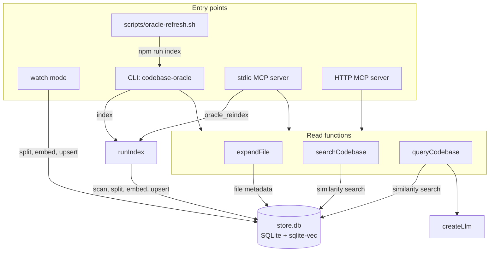
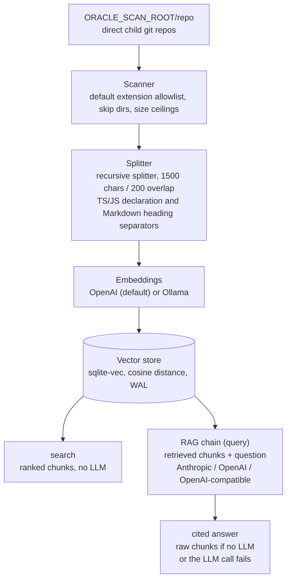

# Architecture

How codebase-oracle turns a directory of git repos into a queryable semantic index.

## Components

The CLI, the stdio MCP server, the HTTP MCP server, watch mode and the refresh script are entry points into the same pipeline functions, and all of them use one store, `store.db` under `ORACLE_DATA_DIR`. The HTTP transport has no reindex tool and no `path_glob` filter.

| Entry point | Command or tool | Calls |
|-------------|-----------------|-------|
| CLI `codebase-oracle` | `index` | `runIndex` |
| | `query` | `queryCodebase` |
| | `search` | `searchCodebase` |
| | `expand` | `expandFile` |
| | `list-repos` | the store's repo listing |
| stdio MCP server (`codebase-oracle mcp`) | `oracle_reindex` | `runIndex` |
| stdio and HTTP MCP servers (`npm run serve` for HTTP) | `oracle_query` | `queryCodebase` |
| | `oracle_search` | `searchCodebase` |
| | `oracle_expand` | `expandFile` |
| | `oracle_list_repos` | the store's repo listing |
| Watch mode (`codebase-oracle watch`) | file events | `splitFile`, `createEmbeddings`, store upserts |
| `scripts/oracle-refresh.sh` | after pulling the repos | `npm run index` |

`runIndex` calls the scanner (`discoverRepos`, `walkRepo`), `splitFile` and `createEmbeddings`, then writes per file to the store. `queryCodebase` and `searchCodebase` run a similarity search against the store, and only `queryCodebase` calls an LLM (`createLlm`). `expandFile` looks up the file's metadata in the store and reads the file from disk. The flowchart shows the same structure.

## Pipeline

The index pipeline turns the repos under the scan root into chunks, embeddings and rows in the store; `search` and `query` read from that store. The flowchart shows the stages in order.

The index pipeline scans every git repo directly under a root directory, splits files into chunks with per-language separators, embeds them via OpenAI-compatible APIs (OpenAI or Ollama), and stores the vectors locally. `search` returns the most relevant chunks without an LLM. `query` feeds them to an LLM for answer generation with source citations, or returns the raw chunks when no LLM is configured or the call fails.

## Chunking

The splitter is LangChain's recursive character splitter with per-language separators: TS/JS split preferably at export, function, class, interface, type and const boundaries, Markdown at headings, and everything else at blank lines and line breaks. Chunks record `lineStart` / `lineEnd` so search results can render as `path:line_start-line_end (repo)`. Older chunks indexed before the line-number rollout fall back to the bare `filePath` form.

Markdown files that lead with a YAML frontmatter block (`---` ... `---` as the first lines) get four additional flat metadata keys: `fmType`, `fmTitle`, `fmTags`, and `fmSources`, read from the frontmatter's `type`, `title`, `tags`, and `sources` fields respectively. Each key is included only when the source field is present with the right type (non-empty string for `fmType`/`fmTitle`, an array of non-empty strings for `fmTags`/`fmSources`); anything else is silently omitted, and the frontmatter text itself is left in the chunked content rather than stripped out. A malformed frontmatter block fails soft: the ingest logs a warning naming the file and continues without any `fm*` keys, never throwing.

The scanner enforces a per-file size ceiling (`ORACLE_MAX_FILE_SIZE`, default 500 KB, checked via `stat` before the file is read into memory) and reports every skipped file, and every file it fails to read, through a loud per-file line plus a run summary rather than dropping them from the index unnoticed. Text/doc file types (currently just `.md`) get a separate, larger ceiling instead (`ORACLE_MAX_TEXT_FILE_SIZE`, default 2 MB): reading a large markdown file fully into memory is harmless — the splitter chunks it downstream regardless of size — so it isn't held to the ceiling sized for arbitrary source files. `npm run watch` mirrors both ceilings, but only reports skips live on the console; it does not update the persisted per-repo count below, which reflects only the last full index run. Each repo's skipped-file count from its last full index run (size vs. read-error) is persisted alongside its `last_indexed_at` timestamp and surfaced on `oracle_list_repos` / `list-repos` whenever it's non-zero, rendered as the total broken down by reason plus up to five example paths (`format-freshness.ts`'s `formatRepoLine`). A repo whose files were skipped in their entirety still appears in the listing (zero chunks, zero files, no freshness timestamp) rather than being dropped from it for lack of any docs.

## OKF-aware retrieval

`oracle_search` (CLI, stdio MCP, and HTTP MCP) accepts optional `type` and `tags` filters over `fmType` / `fmTags`: `type` is a strict-equality match, `tags` requires every listed tag to be present (contains-all). Both only match chunks that HAVE the corresponding field; chunks without frontmatter metadata are excluded whenever a filter is set. Matching results show `fmType` as a `[type]` tag in the header and, when present, a `sources: ...` line built from `fmSources`. `oracle_query` needs no extra params: retrieved chunks' `fmSources` are mechanically unioned (deduped, rank-ordered, capped at 10) into a `Pointers (from OKF sources metadata):` section appended after the answer's sources list, or omitted when no retrieved chunk carries `fmSources`. See [docs/mcp.md](mcp.md#okf-frontmatter-filters-type--tags) for details and examples.

## Embeddings

By default, OpenAI's `text-embedding-3-small` (1536 dimensions). Override with `ORACLE_EMBEDDING_PROVIDER=ollama` and a local embedding model like `nomic-embed-text` to keep everything off the network. See [docs/configuration.md](configuration.md) for the full env var list.

## Vector store: sqlite-vec

Since v0.3.0 the store is a single SQLite file (`store.db`) opened in WAL mode, backed by [sqlite-vec](https://github.com/asg017/sqlite-vec). Implications:

- Writes and reads can safely happen from different processes on the same store.
- A running stdio or HTTP MCP server sees `npm run watch` writes on its next query without restarting.
- Cosine distance for similarity, computed by the virtual table.

## Embedding fingerprint

The store keeps a fingerprint (`embeddingProvider`, `embeddingModel`, `dimension`) in the `meta` table. On load, codebase-oracle refuses to run against a different provider/model: you would get silent garbage otherwise, because the query vector and the stored vectors would live in different embedding spaces (or differ in dimension, producing `NaN` scores).

If you change `ORACLE_EMBEDDING_PROVIDER` or `ORACLE_EMBEDDING_MODEL`, the next `npm run index` / `npm run query` / MCP call will fail fast with a clear message telling you to either delete `~/.codebase-oracle/store.db` (to re-embed with the new model) or revert the env change. There is no automatic migration: the choice is yours.

## Incremental indexing

Indexing is always incremental: a file whose content hash matches the stored hash is reused, only new or changed files are split and embedded, and files that vanished from disk are pruned. The run embeds all changed files first (in batches of 100) and then writes them to the store file by file, so an interrupted run persists none of its new embeddings and the next run embeds those files again.

## Watch mode

`npm run watch` runs a [chokidar](https://github.com/paulmillr/chokidar) watcher over the scan root. File add/change/delete events are accumulated and, after a quiet period (default 3 s, set with `--debounce <ms>`), processed in one batch: changed files are re-embedded, deleted files drop their vectors, vanished repo roots purge all their vectors. Editor save-storms (e.g. VS Code's atomic-rename trick) collapse into a single re-embed thanks to chokidar's `awaitWriteFinish` plus the debounce. Newly dropped `.git` roots are detected and logged; back-fill them with one explicit `npm run index` so the first-time ingestion is consistent, then watch picks up subsequent edits.

Watch mode is additive: it does not replace `npm run index`, which remains the ground-truth bootstrap path.

## Tech stack

- **LangChain.js**: document splitting, embeddings orchestration, RAG chain
- **OpenAI-compatible APIs**: OpenAI and Ollama for embeddings and LLM
- **Claude** (Anthropic): answer generation with source citations
- **MCP SDK**: Model Context Protocol server for Claude Code integration
- **TypeScript** + **Zod**: type-safe configuration and validation

## Credits

The core idea, exposing a semantic index of docs and code to agents through a single MCP endpoint, was inspired by [andrepester/rag-search-mcp](https://github.com/andrepester/rag-search-mcp). codebase-oracle is a Node/LangChain-flavoured take on the same concept, tuned for multi-repo JavaScript/TypeScript workspaces.
